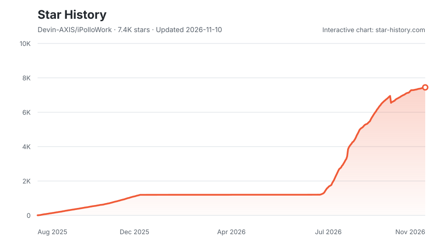

# iPolloWork

English | [中文](README.zh.md)

<p align="center">
  <a href="https://github.com/Devin-AXIS/iPolloWork/releases/latest"></a>
  <a href="https://github.com/Devin-AXIS/iPolloWork/releases"></a>
  <a href="https://github.com/Devin-AXIS/iPolloWork/stargazers"></a>
  <a href="https://x.com/iPolloWork"></a>
  <a href="https://x.com/iPolloCN"></a>
  <a href="https://www.bestpractices.dev/projects/14127"></a>
  <a href="https://www.cloudflare.com/startups/"></a>
  <a href="https://github.com/opea-project"></a>
</p>

<p align="center">
  <a href="https://trendshift.io/repositories/88012?utm_source=trendshift-badge&amp;utm_medium=badge&amp;utm_campaign=badge-trendshift-88012"></a>
  <a href="https://trendshift.io/repositories/88012?utm_source=trendshift-badge&amp;utm_medium=badge&amp;utm_campaign=badge-trendshift-88012"></a>
</p>

**An enterprise collaboration platform for people and AI agents, built on the open-source DeepSeek Harness.**

https://github.com/user-attachments/assets/201b561a-22ec-4c8e-a4e8-f34172cf0aa3

[Download the original demo](docs/assets/ipollowork-demo.mp4)

iPolloWork brings multi-agent teams, shared projects, plugins, Skills and editable work into one workspace. A main assistant coordinates specialists; people share context, follow progress and continue working together across code, documents, presentations, websites, design and video.

The video above is the original iPolloWork demo. The current `main` branch uses the native DeepSeek Harness runtime; the earlier multi-engine edition remains on [`ipollowork-multi-engine`](https://github.com/Devin-AXIS/iPolloWork/tree/ipollowork-multi-engine).

<div align="center">
  <h3>Join the official iPolloWork WeChat community</h3>
  <p>Scan with WeChat for product updates and community discussions.</p>
  
</div>

## What makes it different

- **People and agent teams** — use a main assistant, reusable specialists and native task delegation in the same workspace.
- **Enterprise projects** — organize members and departments, grant project access, share files and project memory, and review submitted changes.
- **Live collaboration** — share a native conversation, let authorized people view or participate, and continue independently through a fork.
- **Plugins and Skills** — use the native plugin lifecycle and curated market, with integrated messaging and project-specific agent instructions.
- **Editable creative work** — use Design and Video views for presentations, websites and visual production, then keep editing the result.
- **Shared services and app data** — discover account-authorized AI capabilities over HTTP and give small apps a record store without their own database.

<a id="run"></a>

<a id="run-from-source"></a>

## Start from source

Use Node.js **24.15 or newer** and **pnpm 11**. Run these commands in a terminal on macOS or Linux:

```sh
git clone --branch main https://github.com/Devin-AXIS/iPolloWork.git
cd iPolloWork
pnpm install
cd plugins/ipollowork-suite
npm ci --ignore-scripts --workspaces=false
cd ../..
pnpm run build --profile local
cd plugins/ipollowork-suite
npm run link:workspace
npm run build
cd ../..
pnpm dsh plugin --profile web add "link:$(pwd)/plugins/ipollowork-suite"
pnpm dsh web
```

In Windows PowerShell, use the same commands but replace the plugin-install command with:

```powershell
pnpm dsh plugin --profile web add "link:$((Get-Location).Path)/plugins/ipollowork-suite"
```

Open the local address printed by the launcher. The suite adds iPolloWork's account, agents and plugin views to the native Web UI. Sign in for configured account services and organization features; local model providers keep their own credentials. Do not paste an account or provider key into a project page.

The account service is deployed separately. Its [setup guide](services/ipollowork/README.md) covers PostgreSQL, account configuration and storage; [capability API documentation](services/ipollowork/docs/capabilities.md) covers external HTTP access. The suite defaults to `https://work.ipollo.net`; configure `accountOrigin` as described in the [suite guide](plugins/ipollowork-suite/README.md) for your own service.

## Desktop and development

The source Web UI runs on macOS, Windows and Linux. Native desktop development and installer packaging use the [Desktop guide](apps/desktop/README.md) and [packaging guide](apps/desktop/packaging/README.md). Published files on [GitHub Releases](https://github.com/Devin-AXIS/iPolloWork/releases) may belong to the earlier multi-engine edition; check the release description before installing.

For ongoing development, see the [development guide](docs/development.md), [integration overview](integrations/README.md) and [architecture](docs/architecture.md). Agent instructions live in [AGENTS.md](AGENTS.md). DeepSeek Harness remains the execution runtime; this branch does not start a second agent engine.

## Community and contributing

Use [GitHub Issues](https://github.com/Devin-AXIS/iPolloWork/issues) for iPolloWork bugs and requests. Read [CONTRIBUTING.md](CONTRIBUTING.md) before submitting changes and [SAFETY.md](SAFETY.md) before running agent tasks. The upstream runtime is maintained by [DeepSeek](https://github.com/deepseek-ai/deepseek-harness).

## Star History

<p align="center">
  <a href="https://www.star-history.com/?repos=Devin-AXIS%2FiPolloWork&amp;type=date&amp;legend=top-left">
    <picture>
      <source media="(prefers-color-scheme: dark)" srcset="https://raw.githubusercontent.com/Devin-AXIS/iPolloWork/star-history/docs/star-history/star-history-dark.svg" />
      <source media="(prefers-color-scheme: light)" srcset="https://raw.githubusercontent.com/Devin-AXIS/iPolloWork/star-history/docs/star-history/star-history-light.svg" />
      
    </picture>
  </a>
</p>

## License

The DeepSeek Harness core retains its [MIT license](LICENSE) and upstream attribution. The iPolloWork suite and account service currently declare `UNLICENSED`; their source is present for review, but that is not an open-source license grant. Third-party components retain their own terms; see [THIRD_PARTY_NOTICES.md](THIRD_PARTY_NOTICES.md).
