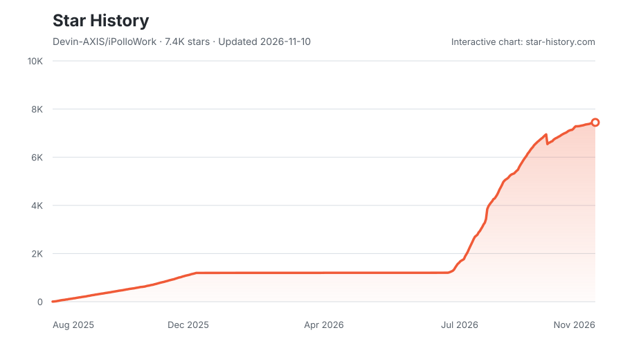

# iPolloWork

[English](README.md) | 中文

<p align="center">
  <a href="https://github.com/Devin-AXIS/iPolloWork/releases/latest"></a>
  <a href="https://github.com/Devin-AXIS/iPolloWork/releases"></a>
  <a href="https://github.com/Devin-AXIS/iPolloWork/stargazers"></a>
  <a href="https://x.com/iPolloWork"></a>
  <a href="https://x.com/iPolloCN"></a>
  <a href="https://www.bestpractices.dev/projects/14127"></a>
  <a href="https://www.cloudflare.com/startups/"></a>
  <a href="https://github.com/opea-project"></a>
</p>

<p align="center">
  <a href="https://trendshift.io/repositories/88012?utm_source=trendshift-badge&amp;utm_medium=badge&amp;utm_campaign=badge-trendshift-88012"></a>
  <a href="https://trendshift.io/repositories/88012?utm_source=trendshift-badge&amp;utm_medium=badge&amp;utm_campaign=badge-trendshift-88012"></a>
</p>

**面向人与 AI 智能体团队的企业级协作平台，基于开源 DeepSeek Harness 构建。**

https://github.com/user-attachments/assets/201b561a-22ec-4c8e-a4e8-f34172cf0aa3

[下载原版演示视频](docs/assets/ipollowork-demo.mp4)

iPolloWork 把多 Agent 团队、共享项目、插件、Skills 和可编辑成果放进同一个工作空间。总助手协调专业智能体，人可以共享上下文、查看进度，并围绕代码、文档、演示文稿、网站、设计和视频继续协作。

上方保留 iPolloWork 原版演示视频。当前 `main` 分支使用原生 DeepSeek Harness 运行时；之前的多引擎版保留在 [`ipollowork-multi-engine`](https://github.com/Devin-AXIS/iPolloWork/tree/ipollowork-multi-engine) 分支。

<div align="center">
  <h3>加入 iPolloWork 官方微信交流群</h3>
  <p>使用微信扫码，获取产品更新并参与社区交流。</p>
  
</div>

## 主要能力

- **人与智能体团队协作** — 在同一个工作空间使用总助手、可复用专业智能体和原生任务委派。
- **企业项目** — 组织成员和部门，授予项目权限，共享文件与项目记忆，并审核提交的改动。
- **实时协作** — 分享原生会话，让获授权的人查看或参与，也可以通过分支独立继续。
- **插件与 Skills** — 沿用原生插件生命周期和精选市场，集成即时通信与项目专属智能体指令。
- **可编辑创作** — 使用 Design、Video 页面制作演示文稿、网站和视觉内容，生成后继续编辑。
- **共享服务与应用数据** — 通过 HTTP 发现账号获授权的 AI 能力，为小型应用提供记录存储，无需另建数据库。

<a id="run"></a>

<a id="run-from-source"></a>

## 从源码启动

需要 **Node.js 24.15 或更新版本**及 **pnpm 11**。在 macOS 或 Linux 终端执行：

```sh
git clone --branch main https://github.com/Devin-AXIS/iPolloWork.git
cd iPolloWork
pnpm install
cd plugins/ipollowork-suite
npm ci --ignore-scripts --workspaces=false
cd ../..
pnpm run build --profile local
cd plugins/ipollowork-suite
npm run link:workspace
npm run build
cd ../..
pnpm dsh plugin --profile web add "link:$(pwd)/plugins/ipollowork-suite"
pnpm dsh web
```

Windows PowerShell 使用相同命令，但将安装插件的一行替换为：

```powershell
pnpm dsh plugin --profile web add "link:$((Get-Location).Path)/plugins/ipollowork-suite"
```

打开启动器输出的本地地址。套件会在原生 Web 界面中加入 iPolloWork 的账号、智能体和插件页面。已配置的账号服务和组织功能需要登录；本地模型提供方继续使用各自的凭据。不要把账号或供应商 Key 粘贴进项目页面。

账号服务单独部署。[部署说明](services/ipollowork/README.zh.md)介绍 PostgreSQL、账号配置和存储；[能力 API 文档](services/ipollowork/docs/capabilities.md)介绍对外 HTTP 接入。套件默认连接 `https://work.ipollo.net`；自建服务请按[套件说明](plugins/ipollowork-suite/README.zh.md)配置 `accountOrigin`。

## 桌面端与开发

源码 Web 界面可在 macOS、Windows 和 Linux 运行。原生桌面开发和安装包构建参见[桌面说明](apps/desktop/README.zh.md)及[打包说明](apps/desktop/packaging/README.zh.md)。[GitHub Releases](https://github.com/Devin-AXIS/iPolloWork/releases)中的已发布文件可能属于之前的多引擎版，安装前请查看对应版本说明。

日常开发参见[开发指南](docs/development.zh.md)、[集成概览](integrations/README.zh.md)和[架构文档](docs/architecture.zh.md)。智能体工作规范见 [AGENTS.md](AGENTS.md)。本分支使用 DeepSeek Harness 执行任务，不会另启一套智能体引擎。

## 社区与贡献

通过 [GitHub Issues](https://github.com/Devin-AXIS/iPolloWork/issues)提交 iPolloWork 问题和需求。贡献前请阅读 [CONTRIBUTING.md](CONTRIBUTING.zh.md)，运行智能体任务前请阅读 [SAFETY.md](SAFETY.zh.md)。上游运行时由 [DeepSeek](https://github.com/deepseek-ai/deepseek-harness)维护。

## Star History

<p align="center">
  <a href="https://www.star-history.com/?repos=Devin-AXIS%2FiPolloWork&amp;type=date&amp;legend=top-left">
    <picture>
      <source media="(prefers-color-scheme: dark)" srcset="https://raw.githubusercontent.com/Devin-AXIS/iPolloWork/star-history/docs/star-history/star-history-dark.svg" />
      <source media="(prefers-color-scheme: light)" srcset="https://raw.githubusercontent.com/Devin-AXIS/iPolloWork/star-history/docs/star-history/star-history-light.svg" />
      
    </picture>
  </a>
</p>

## 许可证

DeepSeek Harness 核心保留 [MIT 许可证](LICENSE)及上游署名。iPolloWork 套件和账号服务目前声明为 `UNLICENSED`；提供源码用于查看，并不等于授予开源使用许可。第三方组件保留各自条款，详见 [THIRD_PARTY_NOTICES.md](THIRD_PARTY_NOTICES.md)。
